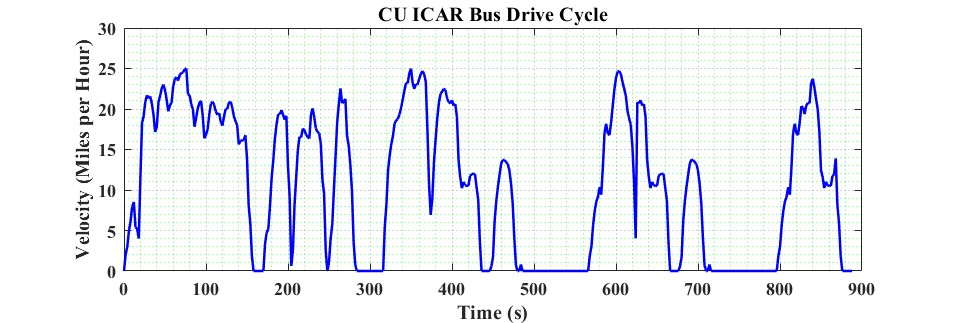

# Series-Parallel Hybrid Powertrain for a Transit Bus

Course project for AuE 6610 Advanced and Electrified Powertrains at Clemson University (CU-ICAR), December 2025.

## Overview
This project compares a conventional diesel powertrain with a series-parallel hybrid for an ENC E-Z Rider II mid-size transit bus. The bus was simulated on two drive cycles built from logged data:
- **Highway route:** CU-ICAR (Greenville) to Clemson main campus
- **City route:** a campus shuttle loop around Clemson



## What we built
- **Diesel baseline:** a 6.7L engine with a BSFC map and an Allison B-series automatic with calibrated shift lines
- **Hybrid model:** a 26 kWh battery, traction motor and ISG (integrated starter-generator), built in MATLAB/Simulink
- **Supervisory controller:** rule-based, state-of-charge (SoC) driven, with three modes:
  - EV
  - Charge-depleting (CD)
  - Charge-sustaining (CS)
- **Regenerative braking** to recover brake energy

## Results
Fuel economy improvement over the diesel baseline:

| Drive cycle | Diesel | Series-parallel hybrid |
|---|---|---|
| City | 7.31 mpg | **+85.5%** |
| Highway | 6.41 mpg | +1.9% |

- The hybrid moves engine operation out of low-efficiency regions.
- Most of the gain comes from low-speed city driving.
- Battery depth of discharge stays low (40–50%), which helps battery life.

## Repository structure
```
matlab/     Controller (PHSB_Controller.m), energy modes, engine output and battery parameter scripts
simulink/   Battery Simulink models
data/       Drive cycle data (.mat)
images/     Drive cycle plots
docs/       Full project report (PDF)
```

## Tools
MATLAB, Simulink

## Team
Diego Noriega Maldonado, Shudip Chakrabartty, Deepak Kumar Nagarajan, Nava Raj Giri
